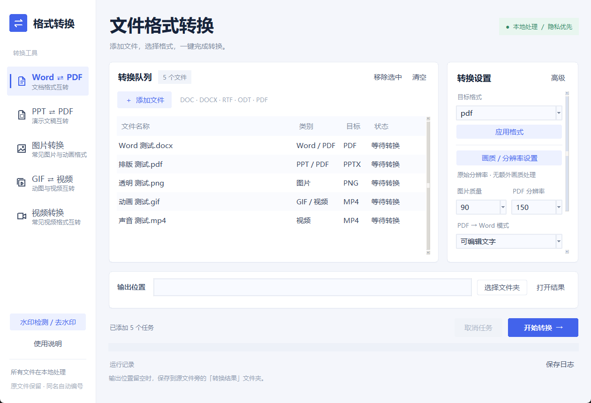

# 格式转换工具

提供 Windows 桌面版与 Android 手机离线版。手机端支持图片、视频/GIF、PDF 处理；电脑版继续提供 Word/PPT 等完整功能。

**[下载 Windows 便携版](https://github.com/senhao730-arch/file-format-converter/releases/tag/v1.0.0)** · **[下载 Android APK](https://github.com/senhao730-arch/file-format-converter/releases/tag/android-v1.0.0)** · [详细使用说明](使用说明.md) · [源码](https://github.com/senhao730-arch/file-format-converter/archive/refs/heads/main.zip)

## Android 手机

Android 8.0+：在手机上打开 [Android 下载页](https://github.com/senhao730-arch/file-format-converter/releases/tag/android-v1.0.0)，下载并安装 `FormatConverter-Android.apk`。独立离线运行，不需要电脑或服务器。

手机首版支持 JPG/PNG/WebP/BMP 输出、图片尺寸与清晰度调整、多图 PDF、视频转 MP4 和裁剪、GIF 转 MP4、PDF 页面导出与压缩、图片/指定 PDF 页的水印候选及框选修补。处理后使用「保存到手机文件夹」或「分享结果」。完整说明与 Android 源码包见 [android/](android/)。

手机首版暂不含 Word/PPT 互转、OCR 和视频水印修补。视频输入依赖手机解码器；PDF 压缩/修补的所有页面会变为图片，文字不可搜索或选择。复杂背景的水印修补可能留痕。原文件保留。

## Windows 使用者

1. 打开上面的下载页，下载 `FormatConverter-Windows-x64.zip`。
2. **完整解压**，双击 `启动程序.bat`。也可以打开 `FormatConverter/FormatConverter.exe`。
3. 不用安装 Python。保留 EXE 旁的 `_internal` 文件夹。

适用 Windows 10/11 64 位。Word、PPT 导出 PDF 需要本机 Microsoft Office 或 LibreOffice；DOC 水印检测需要 Microsoft Word。

## Windows 功能

- Word ⇄ PDF、PPT ⇄ PDF。
- PNG、JPG、WebP、BMP、TIFF、GIF、ICO、AVIF 等图片格式互转，读取 HEIC/HEIF。
- GIF → MP4，以及 MP4、MOV、MKV、AVI、WebM 等视频格式互转。
- 图片和视频的自定义分辨率、等比适应、裁剪、拉伸、锐化、降噪及压缩质量设置。
- 图片、视频、PDF、Word 的水印候选检测和选择处理，支持预览；图片、视频、PDF 可手动框选。
- 批量转换、进度与失败日志、取消任务、同名自动编号。文件在本地处理，原文件保留。



## 结果与限制

- PDF 转 Word 的可编辑模式适用于包含文字的 PDF；扫描件可选择整页图片模式，不提供 OCR。
- PDF 转 PPT 的每页作为图片插入，页内文字不能单独编辑。
- 水印候选可能误检或漏检，不会自动选中或删除。复杂背景的区域修补可能留下痕迹，不跟踪移动水印。
- PDF 框选修补会将涉及页面转成图片，该页文字不能选择或搜索；其他页保留。
- Word 只处理可识别的独立水印图形，预览仅显示对象说明；不修补正文图片内的水印。DOC 输出 DOCX。
- 提高尺寸、锐化不能恢复源文件中不存在的细节。详见[使用说明](使用说明.md)。

## 从源码运行

推荐 Python 3.12/3.13，需包含 tkinter。

```powershell
python -m venv .venv
.\.venv\Scripts\python.exe -m pip install -r requirements.txt
.\.venv\Scripts\python.exe main.py
```

开发测试：`python -m pytest tests -q`。已通过 49 项常规测试，另有 1 项真实 Office 集成测试；验证说明见[验证结果](验证结果.txt)。

## 分享给别人

手机用户可分享 [Android 下载页](https://github.com/senhao730-arch/file-format-converter/releases/tag/android-v1.0.0)，下载 APK 安装。电脑用户可分享 [Windows 下载页](https://github.com/senhao730-arch/file-format-converter/releases/tag/v1.0.0)。

直接分享本仓库首页：https://github.com/senhao730-arch/file-format-converter 。需要让别人直接下载时，分享[最新发布页](https://github.com/senhao730-arch/file-format-converter/releases/latest)。使用者应下载发布页的便携版 ZIP，而不是 GitHub 自动生成的 Source code 包。

## 许可证

项目源码使用 GNU AGPL v3，见 [LICENSE.txt](LICENSE.txt)。便携版和完整源码 ZIP 附带第三方组件许可证，组件来源见[第三方组件说明](第三方组件说明.txt)。
